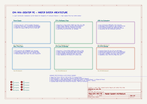
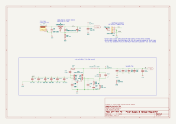
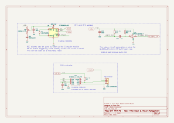
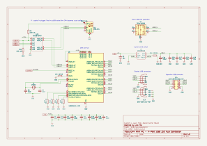
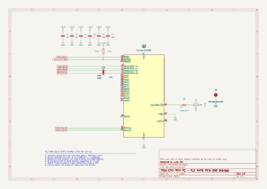

# CM4 Mini PC — 4-Layer High-Speed Carrier Board

[](https://www.kicad.org/)
[]()
[-orange.svg)]()
[]()
[]()

**Designed by Julio Tito** | [GitHub Profile](https://github.com/JulioxTito) | ECE Hardware Portfolio

A custom, compact (~90 mm × 60 mm) 4-layer controlled-impedance carrier board for the **Raspberry Pi Compute Module 4 (CM4)**. Engineered for high-performance mini-desktop computing, embedded industrial workloads, and edge IoT applications with high-speed **PCIe Gen 2.0 M.2 Key-M NVMe SSD** storage.

---

## 📌 Project Overview

While standard consumer Raspberry Pi boards rely on slow MicroSD cards or shared USB 3.0 bridges, this design directly unlocks the CM4’s native single-lane **PCIe Gen 2.0 bus (5.0 Gbps)** to achieve true solid-state read/write throughput exceeding **400+ MB/s** via a dedicated onboard M.2 Key-M NVMe slot.

### 🚀 Key Architectural Upgrades Over Reference CM4IO Board

Unlike the official Raspberry Pi CM4IO evaluation board—which is a large benchtop development platform—this carrier board was re-engineered for a compact, consumer-ready Mini PC:

* **60% Smaller Form Factor**: Shrunk from $160 \times 90\text{ mm}$ down to an ultra-compact $90 \times 60\text{ mm}$ footprint.
* **Integrated M.2 NVMe SSD Storage**: Replaced the bulky desktop PCIe slot with an onboard, low-profile bottom-mount M.2 Key-M socket (supporting 2242 & 2280 NVMe SSDs at 400+ MB/s) with dedicated AC-coupling, 10k$\Omega$ pull-up, and active-low read/write LED.
* **Modern USB-C Power (5V/3A)**: Replaced the 12V DC barrel jack with a standard USB-C port, featuring CC pull-downs, reverse-polarity P-FET, and a 5A synchronous buck converter (`AP64351`) to comfortably handle NVMe power surges.
* **Compact Port Cluster**: Consolidated spread-out ports into a space-saving dual-stacked USB-A receptacle (`J13`) and single primary 4K HDMI 2.0 port.
* **Controlled-Impedance Stackup**: Designed strictly to the JLCPCB JLC04161H 4-layer standard with calculated $100\,\Omega$ (PCIe/HDMI) and $90\,\Omega$ (USB) differential routing.

### Key Architectural Specifications
* **Host Processor**: Raspberry Pi Compute Module 4 (Broadcom BCM2711 Quad-Core Cortex-A72 @ 1.5 GHz).
* **High-Speed Storage**: M.2 Socket 3 (Key-M) supporting NVMe SSDs (standard 2242 & 2280 form factors) with active-low drive read/write activity LED indicator.
* **Fallback Boot Storage**: Push-push MicroSD card slot with high-side load switch power gating (`SD_PWR_ON`) for CM4 Lite booting and OS flashing.
* **Power Delivery Network (PDN)**:
  * Primary Input: 5V / 3A DC via robust USB Type-C receptacle with dual 5.1 kΩ CC configuration channel pull-downs.
  * Synchronous Step-Down Buck Converter: 5V-to-3.3V @ 5A continuous output (`AP64351`) powering the CM4, USB hub controller, and high-draw NVMe SSDs.
  * Circuit Protection: P-channel MOSFET reverse-polarity blocking, TVS diode ESD transient clamping, and low-ESR ceramic decoupling matrix ($10\,\mu\text{F} \times 2 + 100\,\text{nF} \times 4$).
* **Video & Display**: Full-size HDMI Type-A receptacle (`HDMI0`), supporting 4K @ 60 Hz with $100\,\Omega$ differential TMDS pairs, low-capacitance ESD protection arrays, and $3.3\text{V} \leftrightarrow 5\text{V}$ I2C level translation for DDC/EDID handshaking.
* **Networking**: Gigabit Ethernet (10/100/1000 Mbps) via an integrated RJ45 MagJack with internal isolation magnetics and link/activity LEDs.
* **Peripheral Expansion**: 4x USB 2.0 downstream Host ports via a dedicated Microchip `USB2514B` hub controller with external 24.000 MHz quartz crystal oscillator and $90\,\Omega$ differential routing.
* **Real-Time Clock (RTC)**: NXP `PCF85063AT` ultra-low-power I2C timekeeping controller with 32.768 kHz tuning-fork crystal and dedicated CR1220 lithium coin cell battery backup.

---

## 📐 4-Layer Controlled-Impedance Stackup

Engineered to standard **JLCPCB JLC04161H** manufacturing parameters for high-speed signal integrity and low-EMI electromagnetic compliance:

| Layer | Name | Type | Thickness | Copper Weight | Function / Net Assignment |
| :---: | :--- | :--- | :---: | :---: | :--- |
| **L1** | `F.Cu` | Signal | 0.035 mm | 1 oz | High-speed differential pairs (PCIe, HDMI, USB), critical RF signals |
| **--** | Prepreg | 7628 Dielectric | 0.210 mm | -- | Core isolation ($\varepsilon_r \approx 4.5$) |
| **L2** | `In1.Cu` | Plane | 0.035 mm | 1 oz | **Continuous Solid Ground Plane (GND)** for zero-loop return currents |
| **--** | Core | FR-4 Dielectric | 1.065 mm | -- | Mechanical substrate stiffness |
| **L3** | `In2.Cu` | Plane | 0.035 mm | 1 oz | **Split Power Planes** (+5V, +3.3V, +12V) |
| **--** | Prepreg | 7628 Dielectric | 0.210 mm | -- | Core isolation ($\varepsilon_r \approx 4.5$) |
| **L4** | `B.Cu` | Signal | 0.035 mm | 1 oz | Low-speed signals, GPIOs, M.2 bottom socket pads, power flood |

### Controlled Impedance Targets
* **PCIe Gen 2.0 Differential**: $100\,\Omega \pm 10\%$ ($W = 0.254\,\text{mm}$, $S = 0.178\,\text{mm}$, Intra-pair skew $\Delta L < 0.15\,\text{mm}$).
* **HDMI TMDS Differential**: $100\,\Omega \pm 10\%$ ($W = 0.254\,\text{mm}$, $S = 0.178\,\text{mm}$).
* **USB 2.0 Differential**: $90\,\Omega \pm 10\%$ ($W = 0.305\,\text{mm}$, $S = 0.178\,\text{mm}$).
* **Single-Ended Microstrip**: $50\,\Omega \pm 10\%$ ($W = 0.380\,\text{mm}$).

---

## 📑 Complete Schematic Architecture

The design is organized into **7 modular hierarchical sheets**, fully documented and validated with **0 ERC violations**:

* 📄 **[Download Complete Multi-Sheet Schematic PDF](docs/CM4_Mini_PC_Complete_Schematics.pdf)**

### Sheet 1: Master System Architecture Overview
High-level system block diagram, board specifications, and mechanical mounting definitions:


---

### Sheet 2: Power Supply & Voltage Regulation
USB Type-C power input, reverse-polarity P-FET, and AP64351 5V-to-3.3V / 5A synchronous step-down buck converter:


---

### Sheet 3: Real-Time Clock & Power Management
NXP PCF85063AT I2C timekeeper, 32.768 kHz quartz crystal, BAT54C isolation, and CR1220 battery holder:


---

### Sheet 4: CM4 Mezzanine Connectors & HDMI Video
Hirose DF40C high-density mezzanine interface, 4K HDMI Type-A connector, ESD protection diodes, and I2C level shifter:


---

### Sheet 5: Core I/O, Gigabit Ethernet & MicroSD
Gigabit RJ45 MagJack with internal magnetics, push-push MicroSD slot with power gating, and diagnostic LEDs:


---

### Sheet 6: 4-Port USB 2.0 Hub Subsystem
Microchip USB2514B hub controller, 24.000 MHz crystal oscillator, high-side power distribution switches, and dual stacked USB-A receptacles:


---

### Sheet 7: M.2 Key-M NVMe PCIe SSD Storage
Standard M.2 Socket 3 (Key-M), 100nF PCIe TX AC-coupling capacitors, 10kΩ CLKREQ# pull-up, bulk decoupling, and drive activity LED:


---

## 🛠️ Design Verification & ERC Status

The project was compiled and audited using **KiCad 10**'s Electrical Rules Checker (ERC). All hierarchical cross-sheet net labels, power flags, pin electrical types, and reference designators have been audited:

```text
ERC report (CM4_Mini_PC.kicad_sch)
Report includes: Errors, Warnings

***** Sheet /
***** Sheet /Power_Supply/
***** Sheet /Real_Time_Clock/
***** Sheet /CM4_HighSpeed_Video/
***** Sheet /CM4_Core_IO_Storage/
***** Sheet /USB_Hub_Subsystem/
***** Sheet /M2_NVME_Storage/

 ** ERC messages: 0  Errors 0  Warnings 0
Found 0 violations
```

---

## 📁 Repository File Structure

```text
├── docs/
│   ├── CM4_Mini_PC_Complete_Schematics.pdf    # Full 7-sheet vector schematic export
│   └── images/                               # High-resolution vector SVGs for all sheets
│       ├── CM4_Mini_PC.svg
│       ├── CM4_Mini_PC-Power_Supply.svg
│       ├── CM4_Mini_PC-Real_Time_Clock.svg
│       ├── CM4_Mini_PC-CM4_HighSpeed_Video.svg
│       ├── CM4_Mini_PC-CM4_Core_IO_Storage.svg
│       ├── CM4_Mini_PC-USB_Hub_Subsystem.svg
│       └── CM4_Mini_PC-M2_NVME_Storage.svg
├── hardware/
│   ├── CM4_Mini_PC.kicad_pro                  # KiCad 10 Project File
│   ├── CM4_Mini_PC.kicad_sch                  # Root Master Architecture Sheet
│   ├── CM4_HighSpeed.kicad_sch                # CM4 Mezzanine & HDMI Video
│   ├── CM4_GPIO.kicad_sch                     # Core I/O, Ethernet & MicroSD
│   ├── M2_NVME.kicad_sch                      # M.2 Key-M NVMe Storage
│   ├── PSUs.kicad_sch                         # 5V/5A Buck Regulator & USB-C Power
│   ├── RTC.kicad_sch                          # Real-Time Clock & Battery
│   ├── USB2-HUB.kicad_sch                     # 4-Port USB 2.0 Controller
│   ├── CM4_Mini_PC.kicad_pcb                  # 4-Layer PCB Layout file
│   └── CM4_Mini_PC.net                        # Compiled Electrical Netlist
└── README.md
```

---

## 👤 Author & Acknowledgments

* **Hardware Design**: [Julio Tito](https://github.com/JulioxTito) (ECE Hardware Engineering)
* **Compute Architecture**: Based on the [Raspberry Pi Compute Module 4](https://www.raspberrypi.com/documentation/computers/compute-module.html) platform by Raspberry Pi Ltd.
